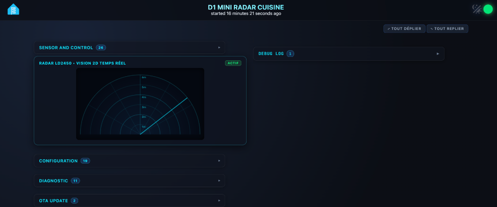
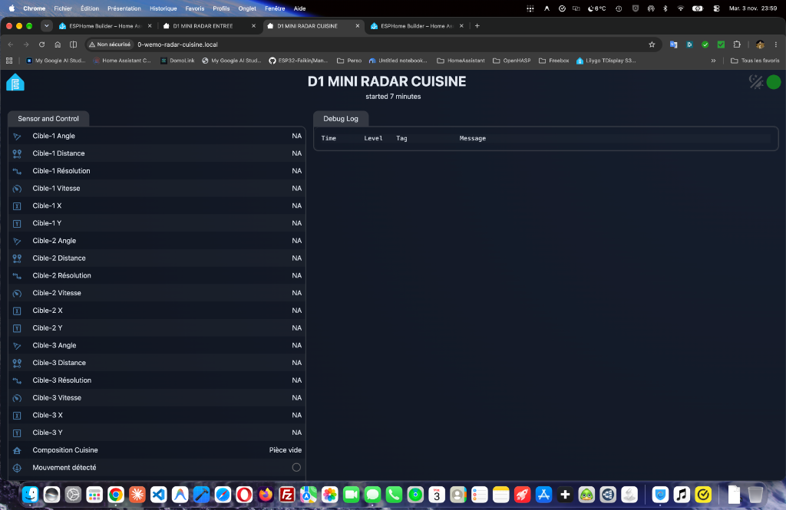
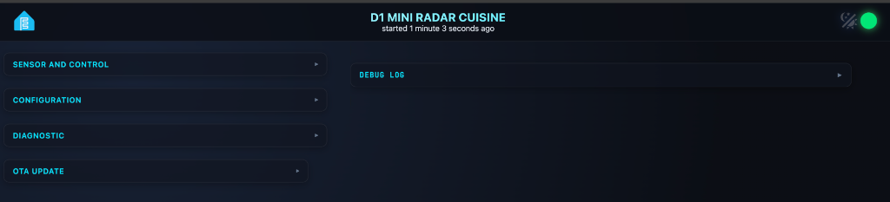

# 📡 ESPHome LD2450 Radar Cyber Dashboard (D1 Mini ESP32)

[](https://esphome.io)
[](https://www.home-assistant.io/)
[](LICENSE)
[](https://www.buymeacoffee.com/Socrate)

> **Transformez votre radar à ondes millimétriques Hi-Link LD2450 et votre ESP32 (Wemos D1 Mini) en une station de détection futuriste avec interface Web Server v3 Glassmorphism, accordéons repliables et affichage radar 2D circulaire en temps réel !**

---

## 📸 Aperçu de l'Interface



### 🔄 Évolution : Avant vs Après

| Avant (ESPHome v3 Brut) | Après (Accordéons Glassmorphism Repliés) |
| :---: | :---: |
|  |  |

---

## ✨ Points Forts & Innovations

### 1. 🎯 Écran Radar 2D Circulaire Interactif en Temps Réel
- Visualisation instantanée de **jusqu'à 3 cibles simultanées** directement sur l'interface embarquée de l'ESP32.
- **Rayons de portée concentriques** (1m à 6m) et angles d'ouverture (-60° à +60°).
- **Ligne de balayage animée** continue avec halo néon.
- Affichage dynamique des coordonnées $(X, Y)$, de la distance et de la vitesse de déplacement pour chaque cible détectée.

### 2. 🛡️ Franchissement du Shadow DOM d'ESPHome v3 (`theme.js`)
- En version 3, le Web Server d'ESPHome enferme ses composants LitElement (`<esp-app>`, `<esp-entity-table>`, `<esp-log>`) dans des **Shadow DOM hermétiques**, rendant inopérantes les feuilles de style externes classiques (`css_include`).
- Grâce à notre script innovant `theme.js`, la feuille de style est **injectée dynamiquement au cœur de chaque Shadow DOM**, débloquant 100 % du design personnalisé sans altérer le firmware d'origine.

### 3. 📂 Accordéons Intelligents avec Mémorisation (`localStorage`)
- **Fini les listes infinies de capteurs :** les blocs *Sensor and Control*, *Configuration*, *Diagnostic*, *OTA Update* et *Debug Log* se présentent sous forme de bandeaux repliés avec chevrons animés.
- **Mémorisation dans le navigateur :** vos sections ouvertes restent ouvertes même après rechargement de la page.
- **Badges de comptage dynamiques :** visualisez en un clin d'œil le nombre d'entités présentes dans chaque section.
- **Barre d'outils rapide :** boutons discrets `⤢ Tout déplier` et `⤡ Tout replier`.

### 4. 🧠 Distinction Humain vs Animal (Chat / Chien)
- Algorithme embarqué basé sur la **résolution de cible du LD2450** et un seuil calibrable dynamiquement depuis Home Assistant (`seuil_resolution_humain`).
- Compteurs distincts en direct : `Nombre d'humains` et `Nombre de chats`, avec composition textuelle en français (*ex: "1 humain, 2 chats"*).
- Filtrage anti-parasite `delayed_on: 100ms` et maintien `delayed_off: 2s` pour éliminer les micro-faux positifs (insectes, courants d'air).

### 5. ⚡ Architecture Optimisée & Haute Vitesse
- **Liaison UART 256 000 bauds** avec tampon circulaire étendu à **2 048 octets** pour garantir zéro paquet radar perdu.
- Optimisation RAM SRAM1/IRAM (`sram1_as_iram: true`).
- Grille symétrique **50% / 50%** fluide et responsive mobile/tablette.

---

## 📁 Structure du Dépôt

| Fichier | Rôle |
| :--- | :--- |
| [`d1-mini-radar-cuisine.yaml`](d1-mini-radar-cuisine.yaml) | Configuration complète ESPHome optimisée pour Wemos D1 Mini32 & LD2450 |
| [`theme.css`](theme.css) | Thème Cyber-Dark & Glassmorphism avec animations néon et accordéons |
| [`theme.js`](theme.js) | Injection Shadow DOM, gestion des accordéons, mémorisation et canvas Radar 2D |
| [`secrets.yaml.example`](secrets.yaml.example) | Modèle de variables sécurisées pour Home Assistant / ESPHome |

---

## 🚀 Installation Rapide

### 1. Préparation des fichiers
Copiez les 3 fichiers suivants dans le dossier de configuration ESPHome de votre Home Assistant (`/config/esphome/`) :
- `d1-mini-radar-cuisine.yaml`
- `theme.css`
- `theme.js`

### 2. Configuration des secrets
Renseignez vos identifiants dans votre fichier `/config/esphome/secrets.yaml` :
```yaml
wifi_ssid: "Votre_SSID"
wifi_password: "Votre_Mot_De_Passe_WiFi"
encryption_key: "Votre_Cle_API_HomeAssistant"
ota_password: "Votre_Mot_De_Passe_OTA"
server_username: "admin"
server_password: "Votre_Mot_De_Passe_Web"
```

### 3. Câblage Hardware (Wemos D1 Mini32 ↔ LD2450)
| Wemos D1 Mini32 | Radar HLK-LD2450 |
| :---: | :---: |
| **5V** | **VCC** (5V) |
| **GND** | **GND** |
| **GPIO17 (TX2)** | **RX** |
| **GPIO16 (RX2)** | **TX** |

### 4. Compilation & Flash
1. Dans le tableau de bord **ESPHome**, cliquez sur **Install** (en USB pour le premier flash, puis en OTA sans fil).
2. Ouvrez l'adresse IP de votre module dans votre navigateur (ex : `http://192.168.1.xxx/`).
3. Profitez de votre radar 2D Cyberpunk ! 🚀

---

## 💡 Astuce Home Assistant (Alléger la Base de Données)
Comme le LD2450 génère des flux de données à haute fréquence, ajoutez cette exclusion dans votre fichier `configuration.yaml` pour préserver votre base SQLite :

```yaml
recorder:
  exclude:
    entity_globs:
      - sensor.*_cible_*
      - sensor.*_target_*
```

---

## ☕ Soutenir le Projet (Buy Me a Coffee)

Si cette interface, l'affichage radar 2D ou la solution de contournement du Shadow DOM vous a été utile et vous a fait gagner des heures de bidouille :

<p align="center">
  <a href="https://www.buymeacoffee.com/Socrate" target="_blank">
    
  </a>
</p>

Un grand merci pour votre soutien et bonne domotique à tous ! 🏠⚡
